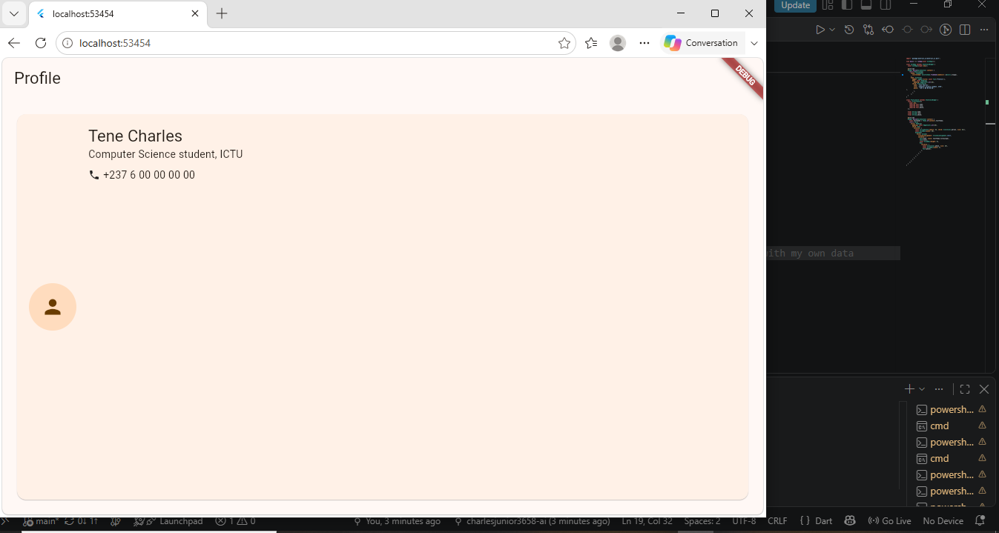
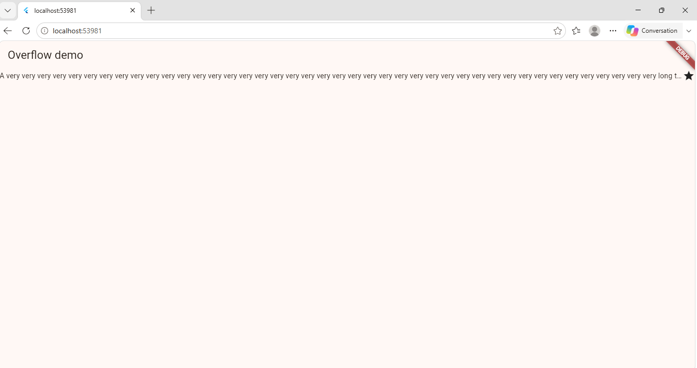
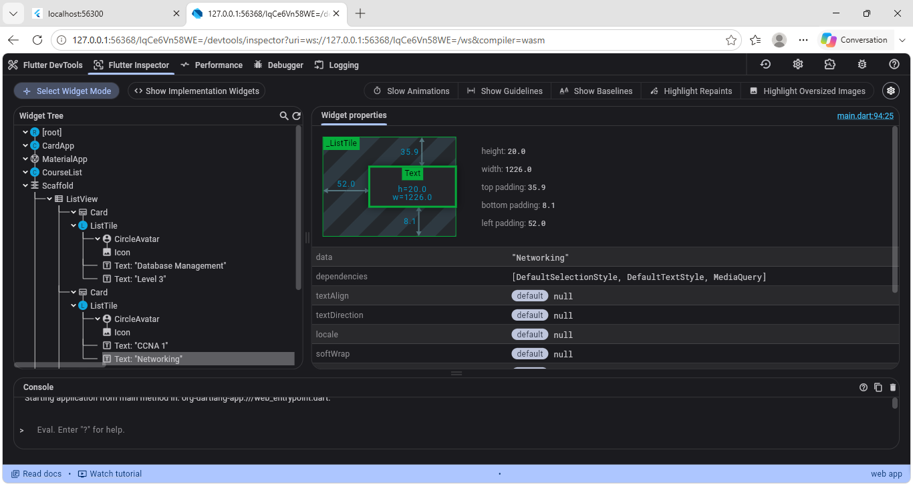

## Lab 2: What I learned and what blocked me
I learned Dart basics in DartPad: named and required parameters, null safety with ??, where/map/fold on lists, a class with a const constructor and a getter, and async/await. In Flutter I typed the ProfileCard widget, changed the seed colour, and built a list of three courses with ListView.builder. I created a RenderFlex overflow on purpose and fixed it by wrapping the Text in Expanded. I used the Flutter inspector to read the size of a widget.

What blocked me: my changes did not show at first because I edited the wrong main.dart, and I could not open DevTools until I used the right link with /devtools/ in it. The inspector did not show the constraints field in my DevTools version, so I explained the rule "constraints go down, sizes go up" in docs/inspector.md instead.

