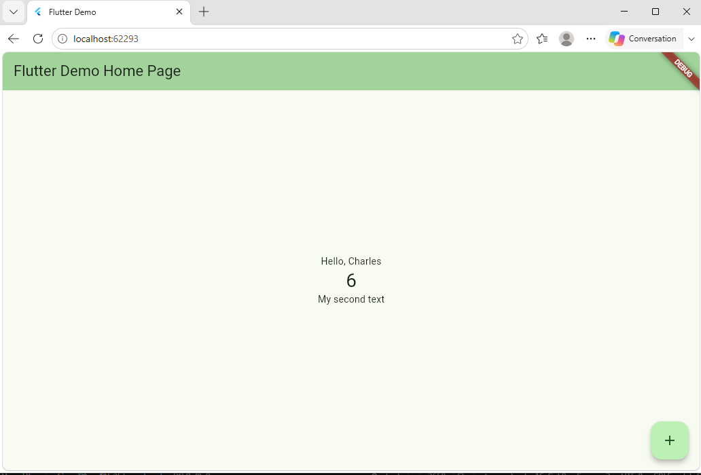
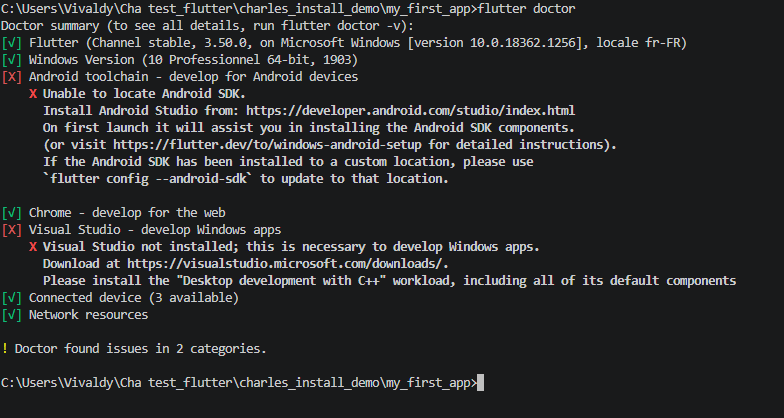

# my_first_app

## What I learned and what blocked me
I learned how to create a Flutter app, run it, and use hot reload and hot restart. Hot reload keeps the state, hot restart re-runs main(). I used debugPrint to read the screen width (1026 dp in the browser). The Android SDK was not installed on my PC, so I ran the app in the browser (Edge/Chrome) instead of an Android device. I also lost time because I was editing a main.dart in the wrong folder, so my changes did not show.

